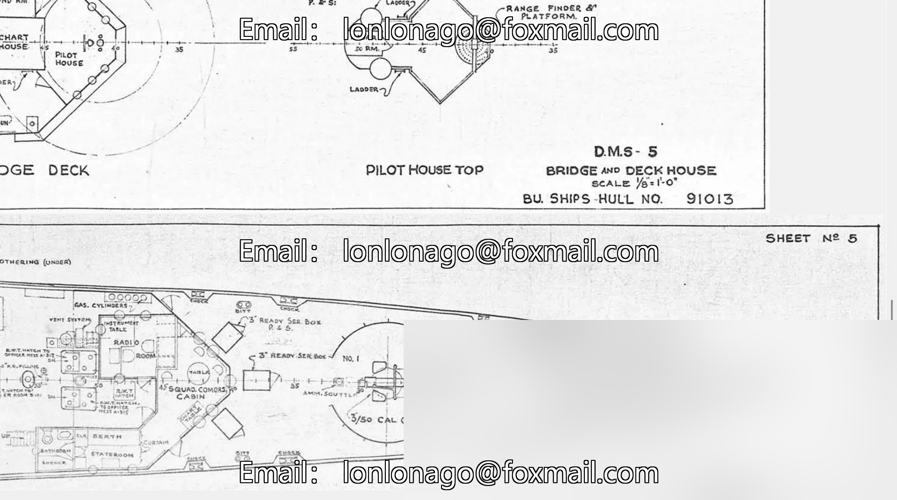
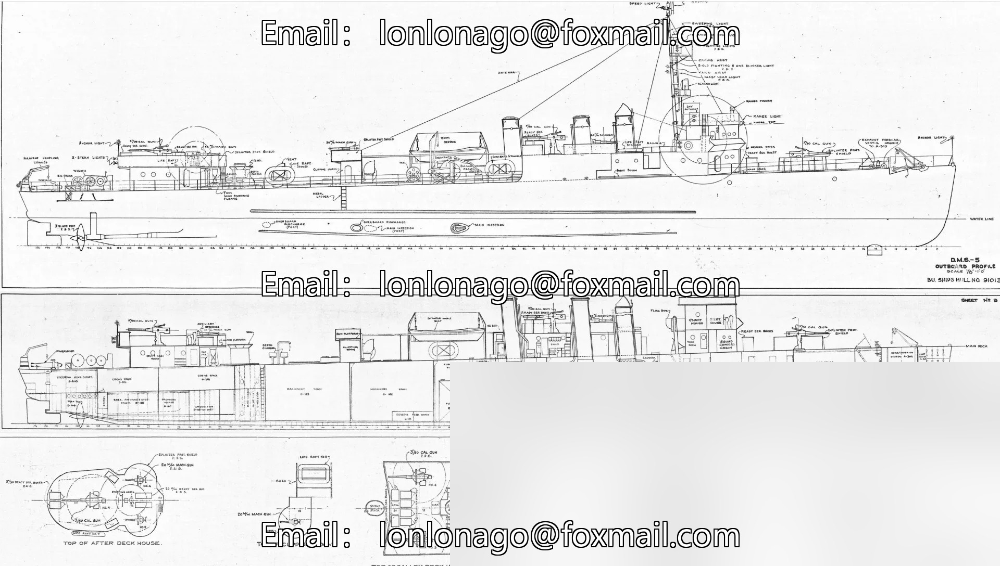
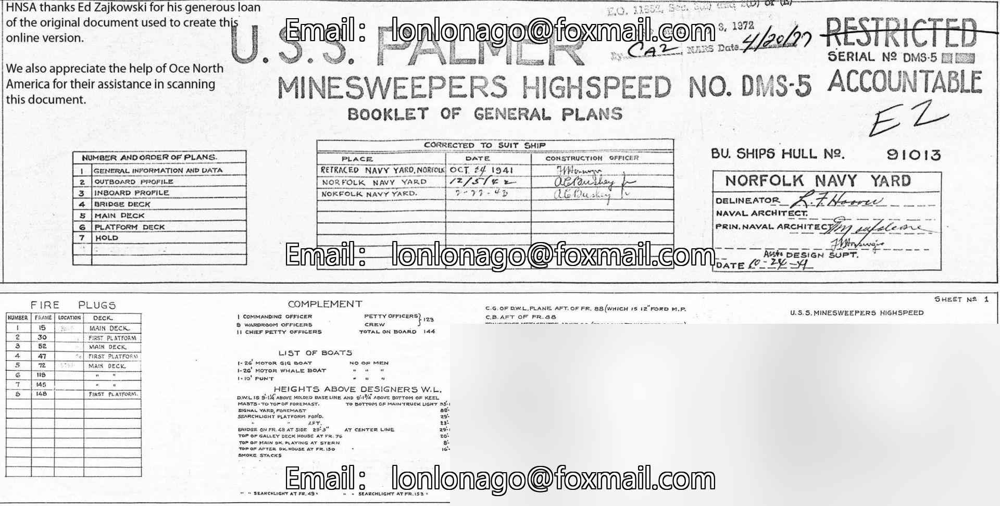

# DMS-5 Palmer high-speed mine sweep flagship overall layout atlas, 1943 multiple Scheeres class

## Body

DMS-5 Palmer's High-Speed Mine Spotting Ship Overall Layout Book, 1943 Docherry-class High-Speed Mine Spotting Ship design materials.
1. Core content analysis
1. Basic information on the ship body
Length of the ship body: 310 feet 11 inches (approximately 95 meters)
Displacement: 2500 tons
Personnel: 144
Equipment: 3 main guns of 3 inches
Multiple small boats are fitted with
2. Detailed design drawings
The complete drawings are clear and complete, including:
Length of the ship body: 310 feet 11 inches
Displacement: 2500 tons
Personnel: 144
Equipment: 3 main guns of 3 inches
Multiple small boats are fitted with
The specific locations and configurations of each cabin, weapon system, and living facilities are clearly annotated
3. Features of the drawings
Electronic version of the materials, convenient for consultation and storage

Suitable for military hobbyists and model making reference
The complete drawings are clear and complete Including the full length of the ship's hull Displacement, Captain's complement, Key parameters of weapons and equipment, Detailed annotations of each cabin, compartment, and area. Weapons system The specific location and configuration of living facilities It is an important reference material for the study of the Dorsa class high-speed mine sweep vessel.

This booklet presents the 1943 Dorset class high-speed minesweeper overall arrangement for the DMS-5 Palmer, covering hull length, displacement, crew numbers, main gun equipment, and detailed cabin, weapon and facility annotations.

<!-- AI_ENRICHED -->

## Images

## Payment

Here is a pay link on Stripe ( https://buy.stripe.com/3cs8yP7sY87d0vu9AB ). Please contact me lonlonago@foxmail.com after funding $89, and I will send you a complete data files , thank you!

